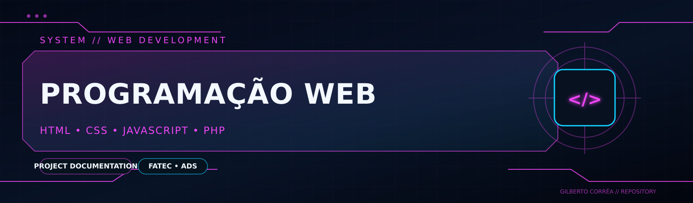
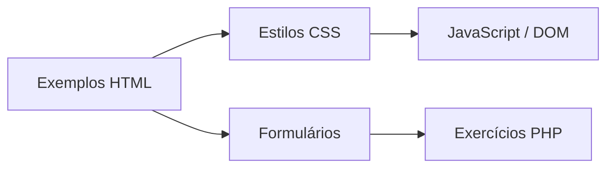

<div align="center">
  
</div>

<div align="center">

# P R O G R A M A Ç Ã O　W E B

### `HTML • CSS • JAVASCRIPT • PHP`

**Laboratório acadêmico de desenvolvimento web: páginas, formulários, scripts e frameworks CSS.**


`FATEC` · `ADS` · `BACKEND / LAB`

[Visão geral](#visao-geral) · [Módulos](#modulos) · [Arquitetura](#arquitetura) · [Execução](#execucao)

</div>

---

<a id="visao-geral"></a>

## `PROJECT // VISÃO GERAL`

Laboratório acadêmico de desenvolvimento web: páginas, formulários, scripts e frameworks CSS.

## `SYSTEM // STATUS`

| Componente | Situação no repositório |
| :--- | :---: |
| Arquivos HTML de exemplos progressivos | `● DOCUMENTADO` |
| Exercícios JavaScript em `javaScript/` | `● DOCUMENTADO` |
| Introdução ao PHP na pasta `PHP/` | `● DOCUMENTADO` |
| Currículo web em `Trabalho_curriculo/` | `● DOCUMENTADO` |
| Exemplos de Bootstrap, Materialize e Pure CSS | `● DOCUMENTADO` |

<a id="modulos"></a>

## `CORE // CONTEÚDO`

- Arquivos HTML de exemplos progressivos
- Exercícios JavaScript em `javaScript/`
- Introdução ao PHP na pasta `PHP/`
- Currículo web em `Trabalho_curriculo/`
- Exemplos de Bootstrap, Materialize e Pure CSS

<a id="arquitetura"></a>

## `ARCHITECTURE // FLUXO CONCEITUAL`



<a id="execucao"></a>

## `BOOT SEQUENCE // EXECUÇÃO LOCAL`

```bash
git clone https://github.com/gilbertocorrea-cmd/Programacao-web.git
cd Programacao-web
```

Abra os arquivos HTML diretamente no navegador ou use um servidor HTTP local. Exemplos PHP precisam de um interpretador/servidor PHP; abrir arquivos `.php` como HTML não executa o processamento.

A documentação detalhada original foi mantida abaixo.

---

## `DOCUMENTATION // DETALHES ORIGINAIS`


> Construindo a base do desenvolvimento para a Web.

---

> [!ABSTRACT]
> Repositório acadêmico da disciplina **Programação Web** da FATEC.
>
> Durante a disciplina foram desenvolvidos exemplos práticos utilizando HTML, CSS, JavaScript e PHP, explorando desde a criação de páginas simples até aplicações com interação dinâmica.
>
> O objetivo foi compreender os fundamentos do desenvolvimento web e a construção de interfaces para usuários.

---

## 🌐 Tecnologias Utilizadas

---

> [!INFO]
> Principais tecnologias estudadas durante a disciplina.

| Tecnologia | Aplicação |
|------------|------------|
| HTML5 | Estrutura das páginas |
| CSS3 | Estilização |
| JavaScript | Interatividade |
| PHP | Processamento no servidor |
| Bootstrap | Framework CSS |
| Materialize | Framework Front-End |
| Pure CSS | Framework CSS Minimalista |

---

## 📚 Conteúdos Estudados

---

> [!INFO]
> Evolução dos conteúdos trabalhados em aula.

### 🏗 HTML

- Estrutura básica de páginas
- Títulos
- Parágrafos
- Links
- Listas
- Tabelas
- Frames
- Navegação

### 🖼 Imagens

- Inserção de imagens
- Logos
- Banners
- Organização de recursos gráficos

### 📋 Formulários

- Inputs
- Select
- Radio Buttons
- Checkboxes
- Formulários HTML

### 🎨 CSS

- Seletores
- Classes
- IDs
- Estilização visual
- Layout

### ⚡ JavaScript

- Variáveis
- Eventos
- Funções
- Manipulação do DOM
- Exercícios práticos
- Validações

### 🐘 PHP

- Introdução ao Back-End
- Processamento de formulários
- Recebimento de dados

### 🚀 Frameworks

- Bootstrap
- Materialize
- Pure CSS

---

## 📂 Estrutura do Projeto

---

> [!INFO]
> Organização dos arquivos da disciplina.

```text
banner.html
principal.html
menu.html

frame1.html
frame2.html
frame3.html

exemplo02.html
...
exemplo31.html

javaScript/
├── exemplo01.html
├── exemplo02.html
├── ...
└── exemplo36.html

PHP/
├── exemplo03.php
├── exemplo04.php
├── exemplo05.php
└── exemplo06.php

Trabalho_curriculo/
└── curriculo.html

img/
├── logo.png
├── fatec.png
├── carro.png
└── demais recursos gráficos
```

---

## 🚀 Projetos Desenvolvidos

---

> [!INFO]
> Exercícios e projetos realizados durante a disciplina.

### 📄 Currículo Web

Projeto de currículo desenvolvido utilizando HTML e CSS.

### 📋 Formulários

Criação e manipulação de formulários para entrada de dados.

### ⚡ Exercícios JavaScript

Exemplos práticos de interação com usuário e manipulação de elementos da página.

### 🐘 Exercícios PHP

Introdução ao desenvolvimento back-end e tratamento de dados enviados por formulários.

### 🎨 Frameworks CSS

Implementação de interfaces utilizando:

- Bootstrap
- Materialize
- Pure CSS

---

## 🧠 Competências Desenvolvidas

---

> [!SUCCESS]
> Conhecimentos adquiridos ao longo da disciplina.

- Estruturação de páginas web
- Criação de interfaces
- Organização de conteúdo
- Estilização com CSS
- Programação com JavaScript
- Integração Front-End e Back-End
- Manipulação de formulários
- Utilização de frameworks CSS

---

## 🔥 Evolução da Disciplina

---

```text
HTML
   ↓
Links
   ↓
Imagens
   ↓
Frames
   ↓
Formulários
   ↓
CSS
   ↓
JavaScript
   ↓
PHP
   ↓
Bootstrap
   ↓
Materialize
   ↓
Pure CSS
```

---

## 🎯 Objetivo da Disciplina

---

> [!INFO]
> Desenvolver os fundamentos necessários para criação de aplicações web modernas, compreendendo tanto o front-end quanto os primeiros conceitos de back-end.

---

## 🎓 Instituição

---

> [!INFO]
> Desenvolvido durante o curso de Análise e Desenvolvimento de Sistemas da FATEC.

```text
FATEC
Análise e Desenvolvimento de Sistemas
Disciplina: Programação Web
```

---

## 🔴 Status

---

> [!TIP]
> Disciplina concluída e mantida como registro da evolução acadêmica em desenvolvimento web e tecnologias voltadas para aplicações web modernas.

---

<div align="center">

## `PROGRAMACAO WEB // BUILD • LEARN • EVOLVE`

**Gilberto Corrêa** · ADS — FATEC

[GitHub](https://github.com/gilbertocorrea-cmd)

</div>
